# GRISM Studio 操作手冊

GRISM Studio 是 GRISM 封包分流器的網頁操作介面。用瀏覽器連上裝置即可使用,不需安裝任何軟體。

在瀏覽器輸入裝置的管理 IP 即可,出廠預設是 `192.168.1.150`;裝置會自動轉到 `https://192.168.1.150/grism-studio/`(HTTP 也會轉成 HTTPS)。

本手冊的畫面取自 GRISM Studio 2.260,機型 G8S-MEC;其他機型的埠數與設定分區略有不同。

---

## 1. 開始使用

### 1.1 登入與帳號權限

右上角帳號選單 →「登入」,輸入裝置的帳號密碼。

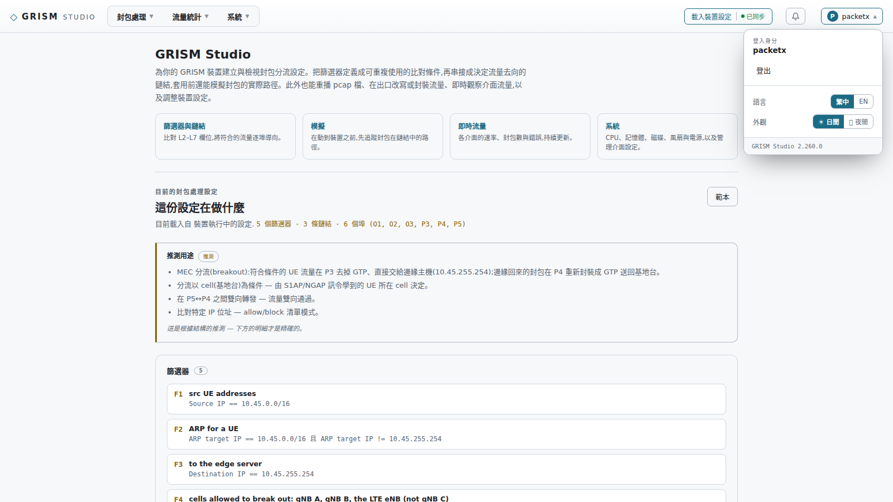

**沒有登入也能用**:Studio 會載入一份範本,讓你先熟悉介面、試著編輯設定。但以下動作都需要登入:

- 載入裝置執行中的設定
- 提交設定到裝置
- 查看流量統計、系統狀態、系統紀錄
- 封包側錄

登入狀態會跟著瀏覽器的 session,重新整理頁面不會掉。

**帳號分四種權限**,在設定 → 登入驗證 → 內部帳號指定:

| 權限 | 可以做的事 |
|---|---|
| **唯讀** | 看所有內容、改瀏覽器裡的草稿;不能提交任何東西 |
| **操作** | 加上封包處理:提交篩選器與鏈結、重播與 pcap 檔、封包側錄、清除計數與 MEC 對應表、bypass 繼電器、確認告警 |
| **設定** | 加上裝置設定:封包處理參數、時區、SNMP、服務、告警、交換器、當機偵錯、重新開機 |
| **系統管理員** | 加上帳號、登入驗證伺服器、管理 IP、管理介面存取限制、韌體、備份與還原、關機 |

權限不夠的按鈕會變灰,硬按會告訴你需要哪一級。任何帳號都可以**變更自己的密碼**;唯讀帳號的設定頁只顯示這一張卡片。裝置上至少要留一位系統管理員,最後一位不能刪除或降級。

### 1.2 畫面結構

頂端導覽分成四個工作區,點一下展開它的分頁:

| 工作區 | 用途 |
|---|---|
| **總覽** | 用文字說明目前這份設定在做什麼 |
| **封包處理** | 編輯設定的主要工作區 |
| **流量統計** | 即時觀察介面、連線、服務、國家分布、MEC 對應表 |
| **系統** | 裝置狀態、紀錄、各項設定 |

### 1.3 頂端工具列

**載入裝置設定** — 抓取裝置執行中的設定並開啟編輯。如果目前有未提交的修改,會先詢問。

按鈕右側有**同步指示**:

- **已同步** — 目前編輯的內容與裝置執行中的完全一致
- **尚未套用的變更** — 已經改了什麼但還沒提交

**問題與警告** — 顯示「有效」或「N 個問題 / N 個警告」。點一下列出明細,每一項都可以「前往」直接跳到出問題的地方。有問題時無法提交。

**復原 / 重作(↶ ↷)** — 只在封包處理工作區出現。每個分區(篩選器、輸入、輸出、動作、鏈結)各自記錄操作歷史。

**告警鈴鐺** — 裝置目前的告警。有未解除的告警時鈴鐺會標示數量,點開看明細並可確認(見 5.3 的「告警」分區)。

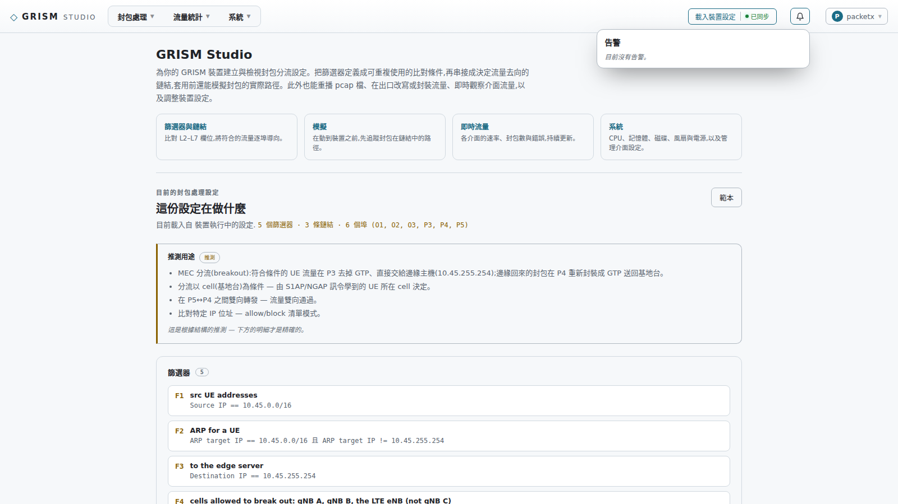

**帳號選單** — 登入/登出、語言(中文 / English)、外觀(日間 / 夜間),底部是 Studio 的版本。

### 1.4 設定的三種來源

工具列會顯示目前設定的來源:

- **裝置執行中的設定** — 從裝置載入的,這是最常見的起點
- **「XXX」範本** — 內建示範設定,尚未針對這台裝置調整過
- **手動輸入的設定** — 在「匯出」頁貼入或編輯過的 XML

> ⚠️ 提交**範本**到裝置時,確認框會特別警示 —— 範本裡的埠號與參數未必符合這台裝置。

---

## 2. 總覽

載入設定後,這一頁用白話說明這份設定在做什麼:有幾個篩選器、幾條鏈結、涉及哪些埠,並**推測用途**。

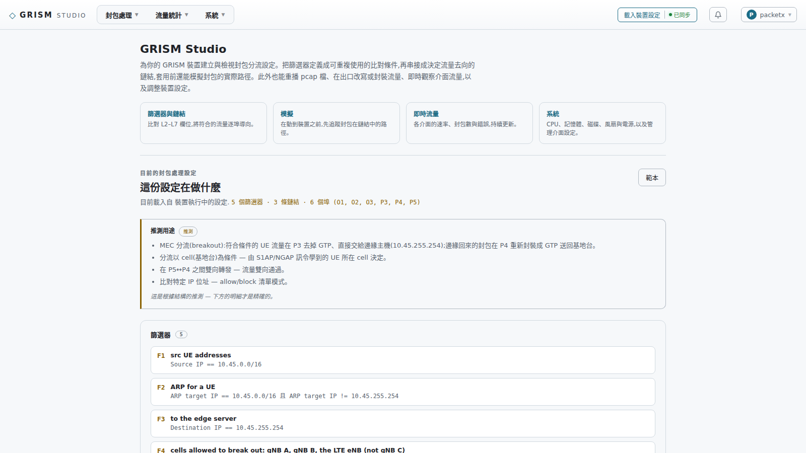

推測用途是從設定的結構讀出來的,第一條會先說這台裝置扮演什麼角色——例如 MEC 分流(哪個埠去掉 GTP、送到哪台邊緣主機、哪個埠封裝回去、是否依 cell 判斷),或 SD-WAN 隧道(L2GRE / VXLAN、哪些埠、隧道走哪個 VLAN、是否單臂、有無 linkdown 切換)——接著才是雙向轉發、負載平衡、丟棄等結構上的觀察。它是推測,下方逐條列出的鏈結與篩選器才是精確的。

**滑鼠移到篩選器或輸出上,會顯示它的詳細條件與動作** —— 不用切到別的分頁就能看懂鏈結。當條件由多個篩選器組成時,會標示「全部符合」(and)或「任一符合」(or)。若篩選器設了 `blockifempty`,語意會自動翻轉顯示。

---

## 3. 封包處理

這是核心工作區。先理解三個概念:

```
篩選器(比對條件)  →  鏈結(決定去向)  →  輸出(送到哪、怎麼改)
```

- **篩選器**定義「什麼樣的封包」,可重複使用
- **鏈結**把入口埠、篩選器、輸出串成一條判斷路徑
- **輸出**定義送到哪個埠,以及要不要改寫、封裝、複製

### 3.1 鏈結

畫布中央呈現一條鏈結的流程圖。左側是鏈結清單(可拖曳排序),右側是編輯欄。

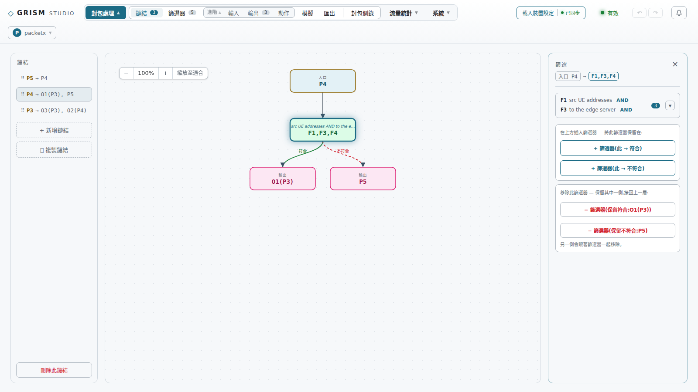

**節點類型**:

| 節點 | 意義 |
|---|---|
| **入口** | 流量從哪些埠進來,永遠在最上方 |
| **篩選** | 一個判斷點,分成「符合」(綠色實線)與「不符合」(紅色虛線)兩條路 |
| **輸出** | 送往哪些埠或具名輸出(`O1`…) |
| **丟棄** | 不轉送 |
| **未指定** | 這一側還沒決定去向;鏈結上至少要有一側有去向 |

**操作方式**:

- 點節點 → 右側編輯欄編輯它的內容;編輯欄最上方顯示這個節點在鏈結裡的位置(入口 → … → 此節點),點任一段可跳到那個節點
- **滑鼠移到節點上會顯示提示**:入口與輸出顯示埠名與描述,以及進階的 VLAN 操作(加標籤 / 移除標籤);篩選節點顯示它實際比對的條件
- 在輸出節點的編輯欄可以「+ 篩選器(此 → 符合)」或「(此 → 不符合)」在它上方插入判斷,並選擇這個輸出保留在哪一側
- 在篩選節點的編輯欄可以「− 篩選器」移除判斷,並選擇保留符合或不符合那一側,接回上一層;另一側會跟著移除
- 編輯只會動到你改的那個節點,其餘節點不會移位
- `Ctrl` + 滑鼠滾輪縮放畫布,拖曳空白處平移,「縮放至適合」回到全圖

**輸出模式**:多個埠時可選「複製」(每個埠都送一份)或「負載平衡」(依指定欄位分流)。

### 3.2 篩選器

左側清單選篩選器,右側編輯它的比對條件。

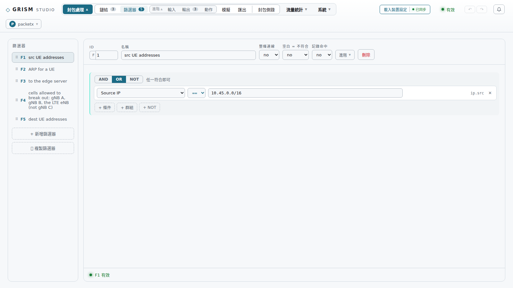

條件以樹狀組合:`and`(全部符合)、`or`(任一符合)、`not`(反向)。每個條件挑一個欄位、一個關係、一個內容,例如「`vlan.id` == `921`」。

可比對的欄位涵蓋 L2 到 L7(MAC、VLAN、IP、埠號、TCP 旗標、TLS/JA4、DNS、GTP、HTTP、MEC 的 cell 等)。**欄位清單由韌體決定** —— 若韌體不支援某個名稱,該條件會被靜默忽略,所以請從清單挑選,不要手動輸入未列出的名稱。

刪除篩選器後,會自動選取**下一個**項目(不會跳回第一個)。輸入、輸出、動作、鏈結的刪除行為相同。

### 3.3 進階:輸入、輸出、動作

這三個分頁收在「進階」群組裡,點開才顯示。

**輸入** — 定義非實體埠的流量來源,例如重播 pcap 檔(`replayPcap`)、流量產生器。

> ⚠️ `replayPcap` 是**從指定埠發送出去**,不是當成入埠流量注入。要讓封包重新進入處理流程,必須用 LOOP 型別的埠。

**輸出** — 定義具名的輸出(`O1`、`O2`…),可以:

- 改寫封包(MAC / IP / 埠號 / TCP MSS)
- 加或移除 VLAN 標籤(Q / QinQ)
- 封裝(VXLAN / NVGRE / GRE / UDP)或去除封裝(GTP、GRE、VXLAN、MPLS…)
- 產生回覆、鏡射、重導
- 限制流量上下限、限制封包長度
- 寫入儲存空間(pcap 檔)

**動作** — 針對入口埠的處理,例如 ARP / ICMP 回覆、入口 VLAN 操作、心跳偵測,以及把兩個埠綁成一組(一邊斷線另一邊也斷)。

### 3.4 模擬

在動到裝置之前,先看封包會走哪條路。

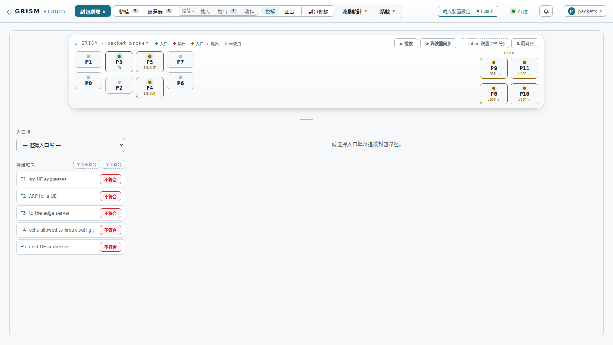

1. 選一個**入口埠**
2. 設定每個篩選器是「符合」或「不符合」(可一鍵全部符合 / 全部不符合)
3. 按「▶ 播放」,畫面會持續送出封包,動畫顯示它的實際路徑

**Inline 裝置**:可以加入虛擬的 inline 裝置(例如 IPS),指定它接在哪兩個埠之間。封包從 A 埠出去會從 B 埠回來,如果 B 埠也有鏈結,會繼續往下跑 —— 這能驗證串接架構的完整路徑。

**輸入**:設定裡的輸入(重播、流量產生器)會以它的埠為起點,點它的標記就從那個埠送出;若那個埠不是 LOOP 也沒有接到 inline 裝置,畫面會說明封包離開裝置、不會進入任何鏈結。

**與裝置同步**:播放鍵旁的切換。開啟後 Studio 會讀取裝置的埠與篩選器計數,把實際在流動的流量畫在對應的埠上,並與設定對照——包括沒有鏈結使用的埠、設定裡用到卻斷線的埠、LOOP 回流與輸出丟棄。畫在面板上的 inline 裝置會被視為真的接著。

篩選器與輸出同樣支援**滑鼠移過顯示細節**。

### 3.5 匯出與提交

這一頁顯示完整的設定 XML,也是提交到裝置的地方。

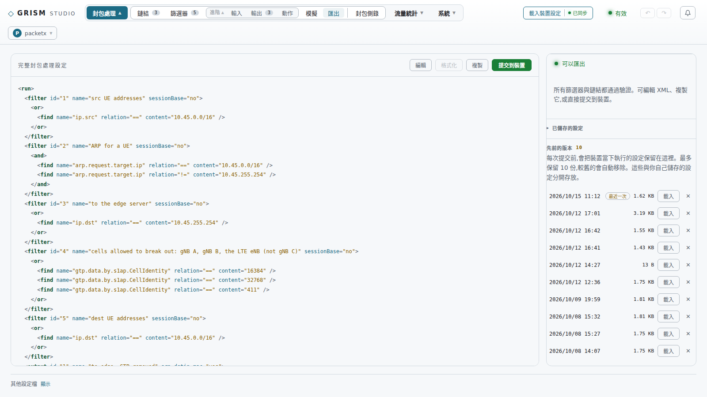

**變更內容(diff)** — 只要設定與載入時不同,就會直接顯示完整檔案的差異,新增/刪除的行以顏色標示。點擊變更計數可以**逐區塊跳到下一處差異**(點「+」跳到新增處、點「−」跳到刪除處)。

**提交到裝置** — 覆蓋裝置執行中的設定並即時套用。有問題未修正時無法提交。

**先前的版本** — 每次提交前,Studio 會自動把裝置當下執行的設定存到裝置,最多保留 **10 份**,較舊的自動移除。在這一頁可以載入任何一份、檢視 diff 後提交回去,也可以刪除。這與下面的「已儲存的設定」分開存放。

**已儲存的設定** — 你主動命名儲存的版本。點擊展開,可載入、改描述、刪除。

**編輯 / 格式化 / 複製** — 可直接編輯 XML 文字後「套用變更」,或複製整份設定。

**其他設定檔** — 頁面底部。裝置上除了執行中的 run.xml 還可能有其他設定檔(例如大型篩選清單的 `run<N>.xml`),可在這裡檢視。

> 💡 未提交的修改**只存在瀏覽器裡**。關掉分頁或重新整理就沒了。要保留請提交、或存成「已儲存的設定」。

### 3.6 封包側錄

把流量錄成 pcap 檔下載回來分析。

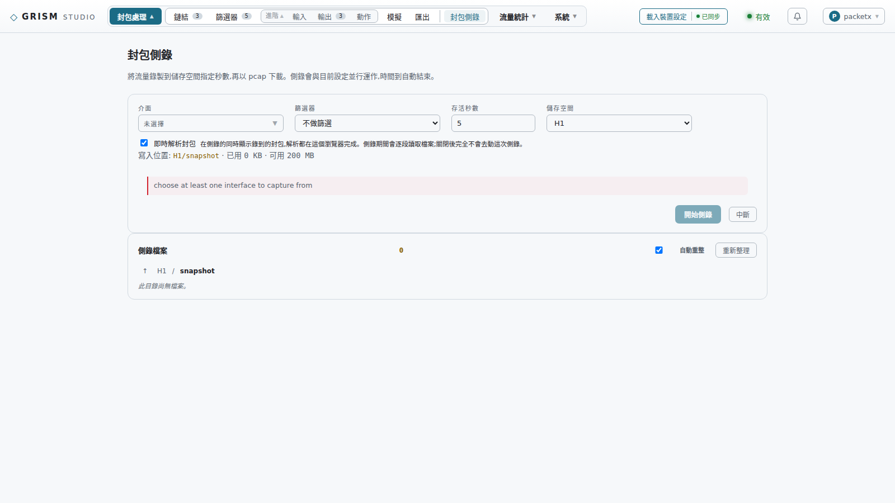

**操作步驟**:

1. 選**介面**(可多選)
2. 選要不要套用**篩選器**(不選則錄全部)
3. 設**存活秒數**(預設 5 秒,時間到自動結束)
4. 選**儲存空間**與**目錄**(卡片會顯示已用 / 可用空間)
5. 按「開始側錄」→ 確認

側錄檔會即時出現在下方清單,寫入中的檔案標示「寫入中」。結束後可下載。

**重要特性**:

- 側錄是一份**並行的暫時設定**,與執行中的設定同時運作,**不會動到 run.xml**
- 開始與中斷都會讓裝置**重新讀取執行中的設定**,所以兩個動作都有確認框
- 存活秒數到了只會停止錄製,設定要按「中斷」才會清除

**改寫風險警告**:如果選的入口埠經過鏈結後會送到一個**會改寫封包的輸出**,Studio 會警示 —— 錄到的內容可能不是原始封包,而且有造成系統異常的風險。此時可以:

- 仍然繼續側錄(接受風險)
- 或讓 Studio **自動改寫設定**:有足夠的空閒 LOOP 埠時,每個會改寫的輸出先繞經一個 LOOP 埠,錄下原始封包;LOOP 埠不夠時改用 VLAN 標籤區分。改好的設定會載入到「匯出」頁,由你檢視後自行提交。

**即時封包檢視(Wireshark 式)**:

開啟後,側錄進行中就能直接在畫面上看到封包內容 —— 清單、詳細解析、十六進位傾印。GRE 或 VXLAN 隧道裡的封包會以隧道內的封包列出。

- 可在側錄**之前**就選擇要不要啟用這個功能
- **保留筆數**可調(200 / 500 / 1000 / 2000 / 5000),超過的舊封包會從頂端捨棄
- **上下方向鍵**移動選取的封包
- 支援 `not` / `and` / `or` 與括號的過濾條件
- 切到別的分頁再回來,若側錄還在進行,會**自動重新開啟**即時檢視

> 💡 過濾是對**解析後的欄位文字**做比對,不是 Wireshark 的過濾語法。

---

## 4. 流量統計

需要登入。每一頁都可以設定自動重整間隔(預設 10 秒)。

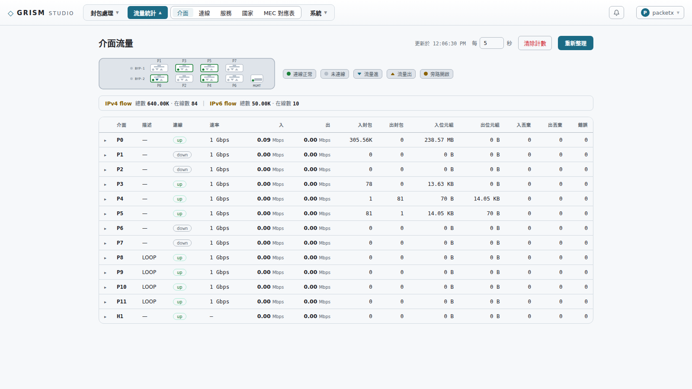

| 分頁 | 內容 |
|---|---|
| **介面** | 各埠的連線狀態、速率、封包數、位元組、錯誤、丟棄;停用的埠以灰色顯示,虛擬埠與實體埠列在一起 |
| **連線** | IPv4 / IPv6 連線表統計:總數、在線數、NetFlow 筆數、協定與埠號分布 |
| **服務** | 依流量使用的埠號辨識服務。點一列可看背後的主機(流量前 100 名),分為對外(公開)與內部(私有) |
| **國家** | 各國流量的封包數、位元組與佔比 |
| **L2GRE 對應表** | 僅在啟用 L2GRE 對應時出現 |
| **MEC 對應表** | 僅在啟用 S1AP/NGAP 關聯時出現:每個 UE 的位址、基地台位址、cell、上下行隧道與流量,可依欄位排序、依位址或閒置時間篩選 |

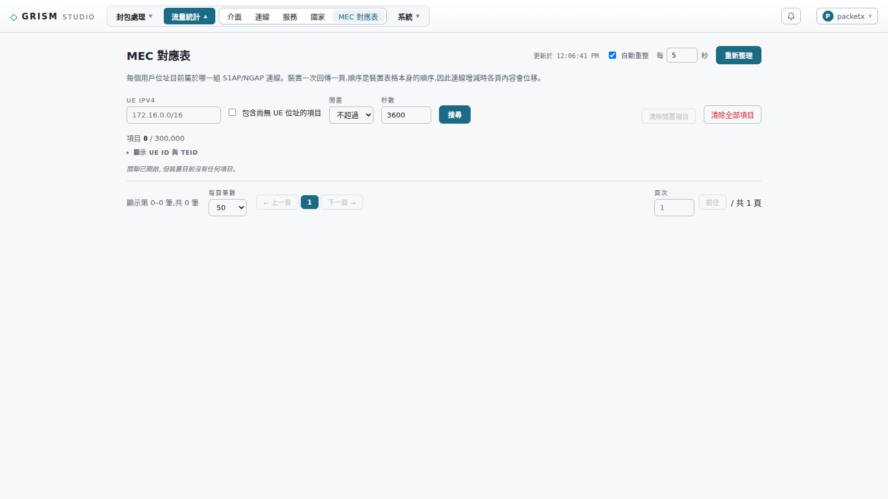

**清除計數** — 把統計歸零重新計算,不影響實際流量。MEC 對應表另有「清除」:移除閒置超過指定秒數的項目。

---

## 5. 系統

### 5.1 系統狀態

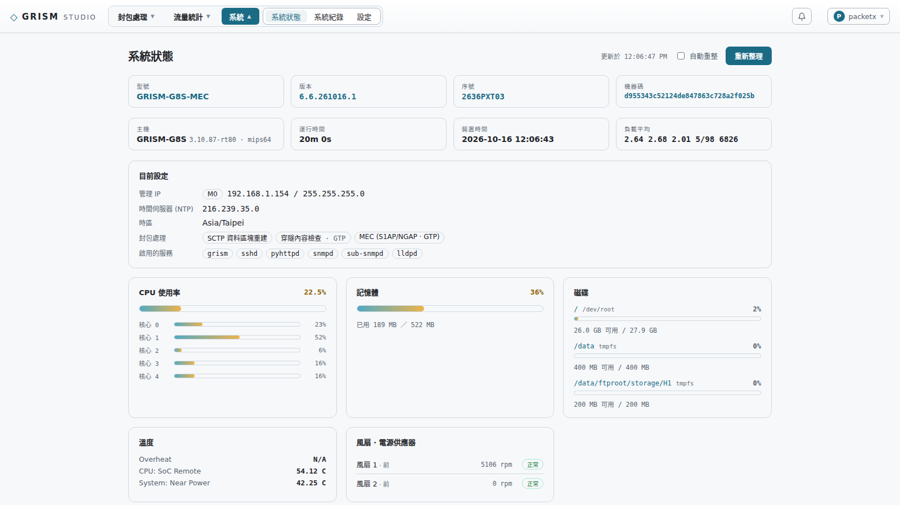

型號、版本、序號、機器碼、主機名稱、運行時間、裝置時間、負載平均;**目前設定**卡片列出管理 IP、NTP、時區、啟用中的封包處理功能與服務;接著是 CPU 使用率(含各核心)、記憶體、磁碟、溫度、風扇與電源。有告警時,清單也顯示在這一頁。

**記憶體卡片**會把「啟動時即固定佔用」的部分單獨列出 —— DPDK hugepages 與流量表(flow table),並以扣除後的數字計算使用率,這樣看到的百分比才有意義。

### 5.2 系統紀錄

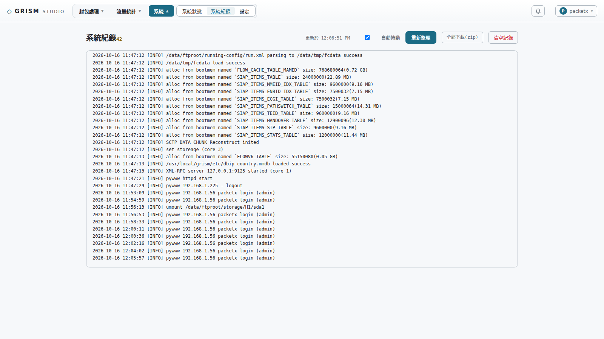

裝置的運作紀錄。可開啟「自動捲動」跟隨最新內容。

紀錄檔超過 10 MB 時,裝置會把它輪替為 `log.txt.1`,較舊的依序往後到 `.4`。有較舊的檔案時,標題旁會出現檔案清單,可以切換檢視任一份;「全部下載(zip)」把目前與所有較舊的紀錄打包成一個 zip。「清空紀錄」會刪除全部(含輪替的舊紀錄),只有系統管理員可以執行,裝置會記下是誰清的。

### 5.3 設定

設定頁分成數個分區(上方切換),不同機型顯示的分區略有不同:

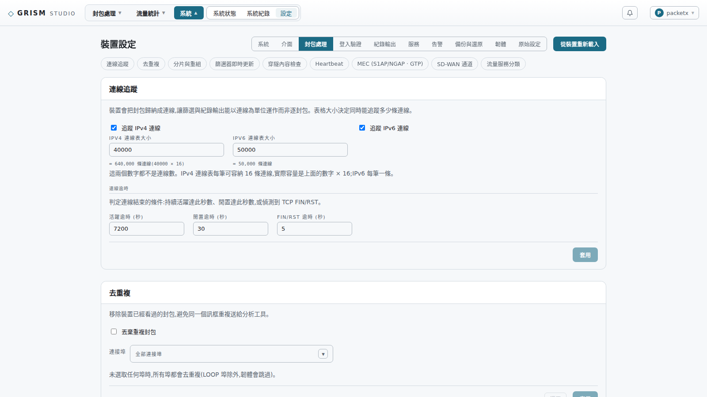

| 分區 | 內容 |
|---|---|
| **系統** | 管理介面 IP、NTP 時間伺服器、時區、DNS、電源(重新開機 / 關機) |
| **介面** | 各埠的啟用、速率、描述、VPORT、LAN-bypass 繼電器 |
| **交換器介面** | 僅前端有 Marvell 交換器的機種(例如 Q16)。詳見下方警告 |
| **封包處理** | 連線追蹤、去重複、分片與重組、篩選器即時更新、穿隧內容檢查、Heartbeat、MEC(S1AP/NGAP・GTP)、SD-WAN 通道、流量服務分類 |
| **登入驗證** | 內部帳號與權限、變更自己的密碼、RADIUS / TACACS+、允許本機帳號登入的來源 |
| **紀錄輸出** | Syslog、NetFlow、DNS 紀錄、TLS 紀錄等輸出設定 |
| **服務** | 各服務的啟用與狀態、版本;手動更新元件、服務選項、管理介面存取限制、SNMP;**當機偵錯**卡片也在這裡 |
| **告警** | 告警規則與門檻、SNMP trap 目標 |
| **備份與還原** | 下載設定備份、從檔案還原、回復原廠設定 |
| **韌體** | 目前版本、上傳韌體、線上更新 |
| **原始設定** | 直接編輯裝置的 XML 設定 |

每個分區的修改都要按「套用」並確認才會寫入裝置。

**登入驗證**

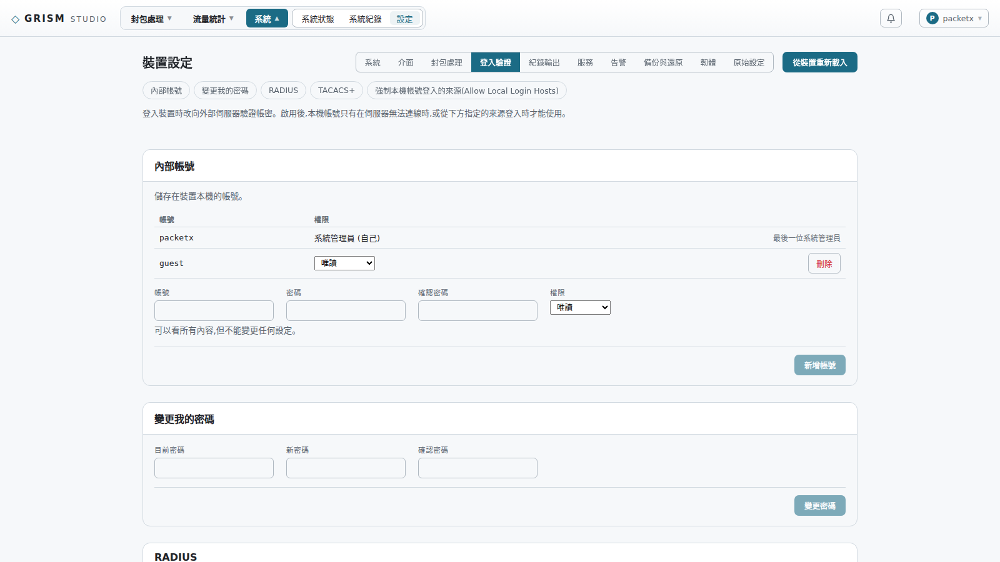

內部帳號表列每個帳號與權限,可新增、刪除、改權限(最後一位系統管理員除外)。啟用 RADIUS 或 TACACS+ 後,登入改向伺服器驗證;「允許本機帳號登入的來源」列出的 IP 或網段仍然用本機帳號登入、不問伺服器——留一條給管理網段,伺服器壞了還進得來。

**MEC(S1AP/NGAP・GTP)卡片**(封包處理分區)

一鍵開啟 MEC breakout 需要的三個功能(S1AP/NGAP 關聯、GTP 穿隧內容檢查、GTP 隧道標頭 flow extension),並設定對應表大小、5G cell id 取 NR Cell Identity 的幾個高位元(`nrCellIdentityBits`,預設 26)、閒置項目的定期清除(cron 與閒置秒數,卡片會把它翻成白話)。卡片上有「4G/5G 行動邊緣運算分流」範本的連結,會在封包處理編輯器建好整套鏈結,換成實際的埠與位址即可。

**告警**

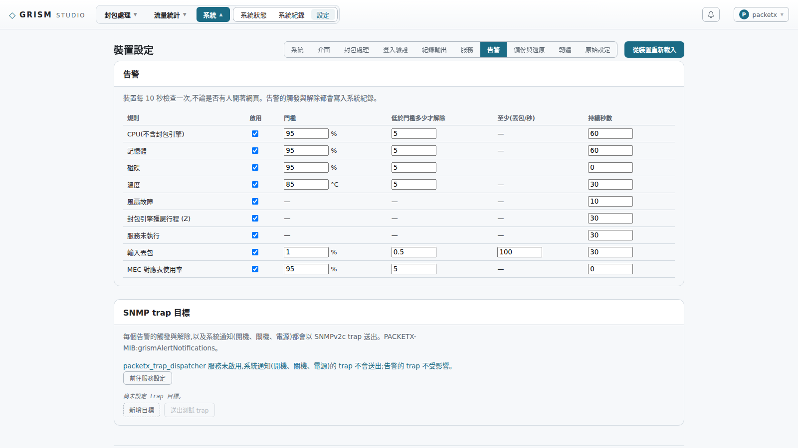

裝置每 10 秒檢查一次,不論有沒有人開著網頁。規則:CPU(不含封包引擎)、記憶體、磁碟、溫度、風扇故障、封包引擎殭屍行程、服務未執行、輸入丟包、MEC 對應表使用率;每條可設門檻、解除門檻與持續秒數。告警的觸發與解除都寫入系統紀錄,並以 SNMPv2c trap 送到「SNMP trap 目標」(可加多個目標,「送出測試 trap」立即驗證接收端);也能從「紀錄輸出」送 syslog。開機、關機、電源的系統通知 trap 由 `packetx_trap_dispatcher` 服務送出,需在服務分區啟用。

**服務**

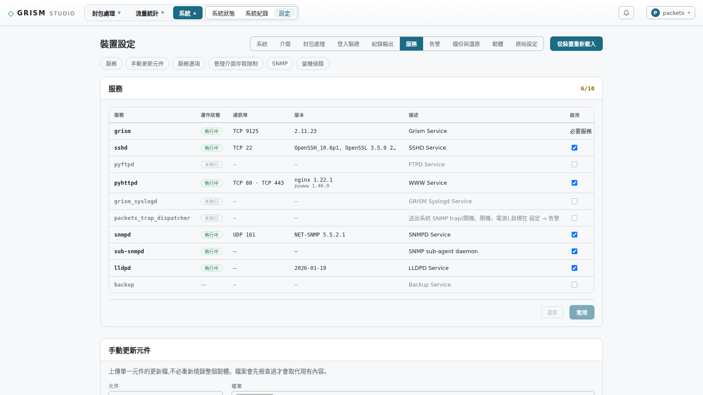

> ⚠️ **交換器介面**:每次寫入都會重啟交換器服務,期間**約 20 秒所有埠都會斷線**。若服務意外停止,會看到十六個埠全暗而封包引擎本身正常 —— 用同一張卡片的重啟功能即可恢復。

### 5.4 當機偵錯

位置:設定 → 服務 → 當機偵錯

封包引擎(grism)如果異常終止,這張卡片是採證與恢復的工具。

**引擎狀態列** — 綠燈 / 紅燈顯示引擎是否存活,並顯示行程數。如果只有部分行程存活(例如 16 剩 8),這裡會直接看得出來。

**建置資訊列** — 顯示機型、韌體版本、revision 前 12 碼,旁邊有「複製回報資訊」按鈕。**回報問題時請一起提供這段資訊** —— 沒有 revision 就無法把 core dump 對應回原始碼。

**引擎當機時寫出 core dump** — 勾選後:

- 立即對**正在執行**的行程生效,不需要重啟
- 重開機後仍保持啟用
- 引擎當機時,系統會自動寫出傾印檔,列在下方可下載
- 最多保留最新 **2 份**

清單上方有 `MANIFEST.txt` 連結,記錄了傾印檔所屬的韌體版本 —— **回報時請與傾印檔一起提供**。

**重新啟動引擎 / 重新開機** — 依平台顯示對應的按鈕:

- 支援線上重啟的機種顯示「重新啟動引擎」,不需重開機
- 部分機種的引擎每次開機只能啟動一次,會顯示「**重新開機**」,並在確認框說明原因

> ⚠️ 部分機種的傾印檔存放在記憶體中,**重新開機會刪除** —— 確認框會提醒,請先下載再重開機。

---

## 6. 常見工作流程

### 新增一條分流規則

1. 登入 → **載入裝置設定**
2. **篩選器**:新增一個篩選器,設定比對條件
3. **鏈結**:選一條鏈結(或新增),在適當位置插入篩選節點,設定「符合 / 不符合」各往哪走
4. **模擬**:選入口埠,試不同的符合組合,確認路徑正確
5. **匯出**:檢查變更內容(diff)
6. **提交到裝置**

### 錄一段流量回來分析

1. 登入 → **封包處理 → 封包側錄**
2. 選介面、(可選)篩選器、存活秒數、儲存空間
3. 若出現改寫風險警告,考慮讓 Studio 自動改寫成 LOOP 方式
4. 「開始側錄」→ 需要的話開啟即時封包檢視邊看邊確認
5. 結束後在清單下載 pcap 檔
6. 按「中斷」清除側錄設定

### 回到上一版設定

1. **匯出**頁 → 右側「先前的版本」(自動保留,最多 10 份)
2. 選一份「載入」→ 檢視 diff
3. 確認無誤後**提交到裝置**

### 建立 MEC breakout

1. 設定 → 封包處理 → **MEC(S1AP/NGAP・GTP)** 卡片:開啟功能、套用
2. 卡片上的「4G/5G 行動邊緣運算分流」範本 → 在編輯器把埠與位址換成實際的(基地台側、核心網側、邊緣主機)
3. 流量統計 → **MEC 對應表**:確認 UE 已被學到、cell 值正確,再把 cell 條件填進篩選器
4. 模擬、匯出、提交

### 引擎當機後的處理

1. 登入 → **設定 → 服務 → 當機偵錯**
2. 勾選「引擎當機時寫出 core dump」(建議平時就開著)
3. 問題重現後,**下載傾印檔與 `MANIFEST.txt`**
4. 按「複製回報資訊」,連同傾印檔一起回報
5. 用「重新啟動引擎」或「重新開機」恢復服務

---

## 7. 疑難排解

| 現象 | 原因與處理 |
|---|---|
| 所有面板都顯示載入失敗 | Session 可能已過期。Studio 偵測到後會提示重新登入 |
| 剛提交完,畫面短暫出現錯誤 | 裝置重新讀取設定需要幾秒,屬正常現象 |
| 按鈕都是灰的、按下去說需要某個權限 | 目前登入的帳號權限不足;請系統管理員在登入驗證分區調整 |
| 無法提交,顯示「修正問題才能提交」 | 點工具列的問題指示,逐項「前往」修正 |
| 改了設定卻沒生效 | 確認同步指示是否為「已同步」—— 編輯過但未提交的內容只在瀏覽器裡 |
| 側錄檔沒有出現 | 確認所選介面確實有流量;LOOP 埠需要有東西送進去才會有封包 |
| 篩選條件似乎沒作用 | 確認欄位是從清單挑選的;韌體不支援的欄位會被忽略 |
| 十六個埠全暗但引擎正常(Q16) | 交換器服務可能停止,到「交換器介面」分區重啟 |
| 鈴鐺一直有告警 | 到系統狀態看是哪一條;門檻在設定 → 告警調整,確認後可暫時消音 |
| 線上更新說沒有這個機型的映像 | 最新的發布資料夾沒有這個機型,請改用上傳韌體 |

---

## 附錄:鍵盤操作

| 按鍵 | 作用 |
|---|---|
| `↑` `↓` | 即時封包檢視中移動選取的封包 |
| `Ctrl` + 滾輪 | 鏈結畫布縮放 |
| `Enter` / 空白鍵 | 鏈結清單中選取反白的鏈結 |
| `Esc` | 關閉彈出視窗 |
